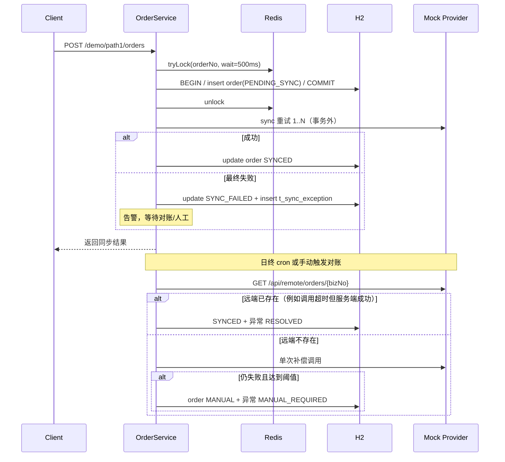
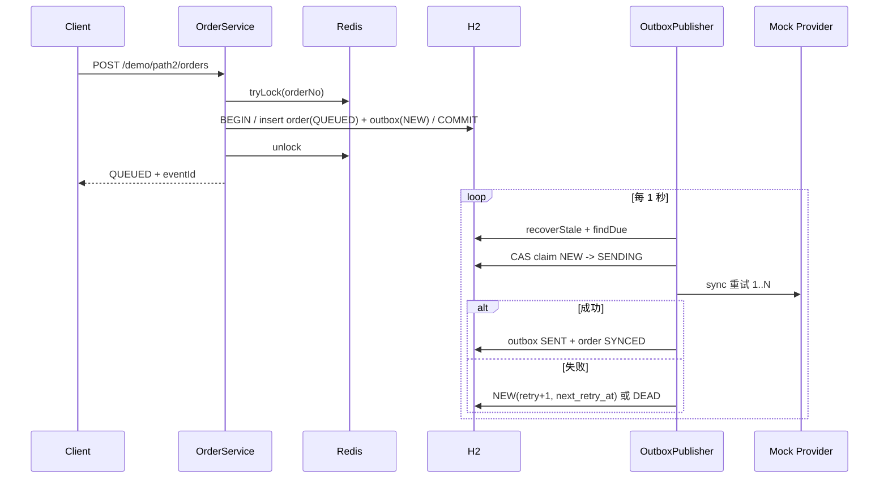

# tx-lock-rpc：事务 / 分布式锁 / RPC 边界实践

同一个 Maven 多模块工程里，用 **Java 17 + Spring Boot 3 + Redisson + HTTP** 对照实现两种“本地事务 + 远程调用”的一致性方案。远程提供方是一个可以注入故障的 Java mock 服务。

- 路径一：**本地事务提交后同步重试 + 待处理异常表 + 对账补偿**
- 路径二：**Outbox（本地消息表）+ 异步发布器 + 重试/死信**

两条路径共享同一条原则：**锁只保护最短的本地临界区，事务只包数据库操作，远程调用绝不在事务内发生。**

## 1. 模块与端口

```
tx-lock-rpc
├── txlock-common          远端请求/响应契约（record DTO）
├── txlock-mock-provider   Java mock 服务商，端口 8081
└── txlock-order-service   订单演示服务，端口 8080（H2 + Redis + Redisson）
```

| 组件 | 说明 |
| --- | --- |
| H2 | 内存库 `jdbc:h2:mem:txlock`，启动自动建表，零外部依赖 |
| Redis | 只用于 Redisson 分布式锁，`docker-compose.yml` 已提供 |
| Mock Provider | 可注入 500 / 超时 / 慢响应 / 业务拒绝；按 `bizNo` 幂等落库 |
| RestClient | `@HttpExchange` 声明式 HTTP 客户端，连接 1s / 读 2s 超时 |

## 2. 快速开始

```bash
# 1. 启动 Redis
docker compose up -d redis

# 2. 安装父 POM 和 common 到本地仓库
mvn -q -DskipTests install

# 3. 终端 A：mock 服务商
mvn -pl txlock-mock-provider spring-boot:run

# 4. 终端 B：订单服务
mvn -pl txlock-order-service spring-boot:run
```

验证：

```bash
curl localhost:8081/api/mock/stats
curl localhost:8080/demo/stats
```

H2 控制台：<http://localhost:8080/h2-console>，JDBC URL 填 `jdbc:h2:mem:txlock;MODE=MySQL;DB_CLOSE_DELAY=-1;DATABASE_TO_LOWER=TRUE`，用户名 `sa`，密码留空。

常用重置：

```bash
curl -X POST localhost:8081/api/mock/reset
curl -X POST localhost:8080/demo/reset
```

## 3. 两条路径对照

| 维度 | 路径一：提交后同步重试 + 对账 | 路径二：Outbox |
| --- | --- | --- |
| 远程调用时机 | 本地事务提交后，同步调用 | 本地事务提交后，发布器异步调用 |
| 事务内容 | 仅订单写入 | 订单写入 + outbox 事件写入 |
| 锁持有范围 | 仅本地写入 | 仅本地写入 |
| 失败兜底 | 有限重试 → 异常表 → 对账 → 人工 | 发布器重试 → 死信 → 重投 |
| 一致性 | 近实时最终一致，不一致可能短暂存在 | 最终一致，延迟取决于发布周期 |
| 适用 | 接口快、失败率低、调用方需要同步结果 | 可接受异步、或下游本身可异步消费 |
| 主要代价 | 需要异常表、对账任务和人工流程 | 需要发布器、死信与积压监控 |

### 路径一流程



### 路径二流程



## 4. 关键设计

### 4.1 锁：只包本地写入

`OrderLockTemplate` 统一“加锁 + 异常兜底 + 释放”，业务方法只负责临界区：

- `tryLock(wait=500ms, lease=5s)`，拿不到立即返回 `409 LOCK_BUSY`，不无限等待。
- 锁内只做一次本地 DB 写入，毫秒级完成，因此固定 lease 足够；不把 RPC 放进锁内，避免长尾请求拖垮锁。
- 解锁前检查 `isHeldByCurrentThread()`，防止 lease 过期后误释放别人的锁。
- 本地唯一索引 `uk_order_no` 是最后一道防线，锁失效时也不会产生重复订单。

### 4.2 事务：显式边界

使用 `TransactionTemplate` 而不是隐式 `@Transactional`，让“事务在哪里提交”在代码里一眼可见：

```java
OrderEntity order = lockTemplate.execute(orderNo, () -> transactionTemplate.execute(status -> {
    orderMapper.insert(entity);
    return entity;
}));
// 这里已经提交并释放锁
remoteCaller.callWithRetry(...);
```

`TransactionTemplate.execute(...)` 正常返回时事务已提交；后续 RPC 一定发生在事务外，不会占着数据库连接等待网络。

### 4.3 RPC：超时、分类重试、幂等

`RemoteCaller` 把失败分成三类：

| 异常 | 类型 | 是否重试 |
| --- | --- | --- |
| `ResourceAccessException`（连接失败 / 读超时） | `TIMEOUT_OR_NETWORK` | 是 |
| `HttpServerErrorException`（5xx） | `REMOTE_5XX` | 是 |
| `HttpClientErrorException`（4xx） | `REJECTED` | 否，确定性拒绝 |
| 其他运行时异常 | `UNKNOWN` | 是 |

- 重试次数默认 3，退避 300ms × 尝试序号（生产建议加随机抖动）。
- **重试的前提是幂等**：所有远程写都带 `bizNo`，mock 按 `bizNo` 去重，重复请求返回 `duplicate=true`。
- **超时不等于失败**：请求可能已在服务端成功，只是响应没回来。对账时先 `GET` 查询，再决定是否补偿。

### 4.4 路径一的异常表与对账

- 失败落 `t_sync_exception`，记录订单号、错误类型、错误信息、累计尝试次数。
- `ReconcileService` 每天 02:00 执行，也可 `POST /demo/path1/reconcile` 手动触发。
- 对账以“未对齐订单 + PENDING 异常”为入口：
  1. 先查远端，存在 → 直接置为 `SYNCED`，异常置 `RESOLVED`；
  2. 远端不存在 → 只做**一次**补偿调用，避免对账任务在故障期间放大流量；
  3. 累计尝试次数达到 `demo.reconcile.max-attempts=5` → 订单 `MANUAL`、异常 `MANUAL_REQUIRED`，转人工；
  4. `MANUAL` 订单只做远端确认，不再自动重发；修复后可调 `POST /demo/path1/orders/{orderNo}/resync` 人工补偿。

### 4.5 路径二的 Outbox

- 订单与事件在**同一个本地事务**写入，天然满足“业务成功则事件必存在”。
- 发布器每 1 秒轮询 `NEW` 且 `next_retry_at <= now` 的事件。
- `claim` 用一条带状态条件的更新做 CAS：

```sql
UPDATE t_outbox_event
SET status = 'SENDING', locked_until = ?
WHERE id = ? AND status = 'NEW'
```

  受影响行数为 1 才继续发送，多实例部署时同一事件只会被一个发布器领走。
- 发送成功：`SENT` + 订单 `SYNCED`，两个更新在同一本地事务里。
- 发送失败：`retry_count + 1`，按退避时间回到 `NEW`；达到 `max-retry=5` 进入 `DEAD` 死信。
- `locked_until` 过期仍是 `SENDING` 的事件会被 `recoverStale` 重置为 `NEW`，覆盖发布器崩溃场景；重复发送由远端 `bizNo` 幂等兜底。
- 死信可 `POST /demo/path2/outbox/{id}/requeue` 重投。

## 5. 接口清单

### Mock 提供方（8081）

| 方法 | 路径 | 说明 |
| --- | --- | --- |
| POST | `/api/remote/orders` | 接收订单同步，按 `bizNo` 幂等 |
| GET | `/api/remote/orders/{bizNo}` | 查询远端是否已有该订单 |
| GET | `/api/remote/orders` | 列出所有已落库订单 |
| POST | `/api/mock/control` | 注入故障：`{"mode":"FAIL","times":2,"delayMs":0}` |
| GET | `/api/mock/stats` | 调用次数、成功、重复、失败、超时、已存订单数 |
| POST | `/api/mock/reset` | 清空 mock 状态与订单 |

故障模式：

| mode | 行为 |
| --- | --- |
| `SUCCESS` | 正常落库并返回 |
| `FAIL` | 返回 500，不落库 |
| `TIMEOUT` | 先等待（默认 5s，大于客户端读超时），**之后仍然落库** |
| `SLOW` | 延迟（默认 300ms）后正常落库 |
| `REJECT` | 返回 409，不落库，客户端不重试 |

`times > 0` 只影响接下来 N 次请求；`times <= 0` 或缺省表示一直生效，直到重新设置。

### 订单服务（8080）

| 方法 | 路径 | 说明 |
| --- | --- | --- |
| POST | `/demo/path1/orders` | 路径一创建订单：锁 + 本地事务 + 提交后同步重试 |
| POST | `/demo/path1/reconcile` | 手动触发对账 |
| GET | `/demo/path1/exceptions` | 查看异常表 |
| POST | `/demo/path1/orders/{orderNo}/resync` | 人工补偿 |
| POST | `/demo/path2/orders` | 路径二创建订单：业务 + outbox 同事务 |
| POST | `/demo/path2/publish` | 手动跑一轮发布器 |
| GET | `/demo/path2/outbox` | 查看 outbox |
| POST | `/demo/path2/outbox/{id}/requeue` | 死信重投 |
| GET | `/demo/orders` | 最近订单 |
| GET | `/demo/orders/{orderNo}` | 订单详情 |
| GET | `/demo/stats` | 订单/事件/异常按状态统计 |
| POST | `/demo/locks/hold?orderNo=X&holdMs=3000` | 演示用：占锁一段时间 |
| GET | `/demo/locks/{orderNo}` | 查看锁状态 |
| POST | `/demo/reset` | 清空 H2 三张表 |

创建订单请求体：

```json
{"orderNo": "P1-OK", "amount": 99.00}
```

`orderNo` 可省略，服务端生成 UUID；金额必须大于 0。

## 6. 实验剧本

以下命令都在 Git Bash / Linux shell 中执行。开始前先重置：

```bash
curl -s -X POST localhost:8081/api/mock/reset; echo
curl -s -X POST localhost:8080/demo/reset; echo
```

### 实验 1：路径一快乐路径

```bash
curl -s -X POST localhost:8080/demo/path1/orders \
  -H 'Content-Type: application/json' \
  -d '{"orderNo":"P1-OK","amount":99.00}'; echo

curl -s localhost:8080/demo/orders/P1-OK; echo
curl -s localhost:8081/api/remote/orders/BIZ-P1-OK; echo
```

预期：订单 `SYNCED`，`syncAttempts=1`；远端可以查到 `bizNo=BIZ-P1-OK`。

### 实验 2：失败两次后重试成功

```bash
curl -s -X POST localhost:8081/api/mock/control \
  -H 'Content-Type: application/json' \
  -d '{"mode":"FAIL","times":2}'; echo

curl -s -X POST localhost:8080/demo/path1/orders \
  -H 'Content-Type: application/json' \
  -d '{"orderNo":"P1-RETRY","amount":10.00}'; echo
```

预期：返回 `SYNCED`，`syncAttempts=3`；mock 统计 `failed=2, accepted=1`。

### 实验 3：超时但远端成功，对账修复（推荐重点看）

```bash
curl -s -X POST localhost:8081/api/mock/control \
  -H 'Content-Type: application/json' \
  -d '{"mode":"TIMEOUT","times":-1,"delayMs":3000}'; echo

# 客户端读超时 2s，会重试 3 次；整个请求约 7s
curl -s -X POST localhost:8080/demo/path1/orders \
  -H 'Content-Type: application/json' \
  -d '{"orderNo":"P1-TIMEOUT","amount":20.00}'; echo
```

预期：

- 接口返回 `SYNC_FAILED`、`errorType=TIMEOUT_OR_NETWORK`、`syncAttempts=3`；
- `t_sync_exception` 有一条 `PENDING`；
- mock 侧订单其实已经落库（`accepted=1`，后续重试产生 `duplicates`）。

恢复并只对账、不重发：

```bash
curl -s -X POST localhost:8081/api/mock/control \
  -H 'Content-Type: application/json' -d '{"mode":"SUCCESS"}'; echo

sleep 1
curl -s -X POST localhost:8080/demo/path1/reconcile; echo
curl -s localhost:8080/demo/path1/exceptions; echo
curl -s localhost:8080/demo/orders/P1-TIMEOUT; echo
```

预期：对账结果 `remoteFound=1, compensated=0`；订单 `SYNCED`，异常 `RESOLVED`。这演示了“先查后补”如何避免把已经成功的请求再发一遍。

### 实验 4：持续失败 → 人工升级 → 人工补偿

```bash
curl -s -X POST localhost:8081/api/mock/control \
  -H 'Content-Type: application/json' -d '{"mode":"FAIL","times":-1}'; echo

curl -s -X POST localhost:8080/demo/path1/orders \
  -H 'Content-Type: application/json' -d '{"orderNo":"P1-MANUAL","amount":30.00}'; echo

# 第一次对账：累计 3 + 1 = 4 次，仍 PENDING
curl -s -X POST localhost:8080/demo/path1/reconcile; echo

# 第二次对账：累计 5 次，达到阈值，转 MANUAL
curl -s -X POST localhost:8080/demo/path1/reconcile; echo

curl -s localhost:8080/demo/orders/P1-MANUAL; echo
curl -s localhost:8080/demo/path1/exceptions; echo
```

恢复 mock 后人工补偿：

```bash
curl -s -X POST localhost:8081/api/mock/control \
  -H 'Content-Type: application/json' -d '{"mode":"SUCCESS"}'; echo

curl -s -X POST localhost:8080/demo/path1/orders/P1-MANUAL/resync; echo
```

预期：第二次对账订单 `MANUAL`、异常 `MANUAL_REQUIRED`；人工补偿后订单 `SYNCED`、异常 `RESOLVED`。

### 实验 5：路径二快乐路径

```bash
curl -s -X POST localhost:8080/demo/path2/orders \
  -H 'Content-Type: application/json' -d '{"orderNo":"P2-OK","amount":50.00}'; echo

# 刚创建：订单 QUEUED，事件 NEW
curl -s localhost:8080/demo/orders/P2-OK; echo
curl -s localhost:8080/demo/path2/outbox; echo

# 等发布器下一轮（最多 1 秒）
sleep 2
curl -s localhost:8080/demo/orders/P2-OK; echo
curl -s localhost:8080/demo/path2/outbox; echo
```

预期：订单 `QUEUED` → `SYNCED`，事件 `NEW` → `SENT`。

### 实验 6：路径二重试与死信重投

```bash
curl -s -X POST localhost:8081/api/mock/control \
  -H 'Content-Type: application/json' -d '{"mode":"FAIL","times":-1}'; echo

curl -s -X POST localhost:8080/demo/path2/orders \
  -H 'Content-Type: application/json' -d '{"orderNo":"P2-DEAD","amount":60.00}'; echo

# 也可以不等调度，连续手动推几轮（retry_count 到 5 即进入 DEAD）
for i in 1 2 3 4 5 6 7 8; do
  curl -s -X POST localhost:8080/demo/path2/publish; echo
  sleep 2
done

curl -s localhost:8080/demo/path2/outbox; echo
```

预期：事件依次经历 `NEW → SENDING → NEW(retry_count 递增) → DEAD`，订单保持 `QUEUED`。记下 DEAD 事件的 `id`，恢复 mock 后重投：

```bash
curl -s -X POST localhost:8081/api/mock/control \
  -H 'Content-Type: application/json' -d '{"mode":"SUCCESS"}'; echo

# 把 {id} 换成上一条查询结果里的数字 id
curl -s -X POST localhost:8080/demo/path2/outbox/{id}/requeue; echo
sleep 2
curl -s localhost:8080/demo/orders/P2-DEAD; echo
```

预期：事件 `SENT`，订单 `SYNCED`。

### 实验 7：锁等待与锁冲突

终端 A 占锁 3 秒：

```bash
curl -s -X POST 'localhost:8080/demo/locks/hold?orderNo=LOCK-A&holdMs=3000'; echo
```

在 3 秒内，终端 B 发起同订单创建：

```bash
curl -s -X POST localhost:8080/demo/path1/orders \
  -H 'Content-Type: application/json' -d '{"orderNo":"LOCK-A","amount":1.00}'; echo
```

预期：B 等 500ms 后返回 `409 LOCK_BUSY`。A 释放后再创建则成功。

把 `holdMs` 改成 300ms，再立即发起创建，可以看到 `tryLock` 等待后成功拿到锁。

### 实验 8：本地重复与远端幂等

```bash
# 本地唯一索引 + 锁：第二次创建返回 409 DUPLICATE_ORDER
curl -s -X POST localhost:8080/demo/path1/orders \
  -H 'Content-Type: application/json' -d '{"orderNo":"P1-OK","amount":99.00}'; echo
```

远端幂等可以结合实验 3 观察：超时重试会产生多次 HTTP 请求，但 mock 只保存一个订单，`duplicates` 计数递增。

## 7. 关键代码索引

| 关注点 | 文件 |
| --- | --- |
| 锁编排 | `txlock-order-service/.../lock/OrderLockTemplate.java` |
| 显式事务模板 | `txlock-order-service/.../config/TxConfig.java` |
| 路径一主流程 | `txlock-order-service/.../service/Path1OrderService.java` |
| 异常表写入 | `txlock-order-service/.../service/SyncExceptionRecorder.java` |
| 对账/补偿/升级 | `txlock-order-service/.../service/ReconcileService.java` |
| 路径二主流程 | `txlock-order-service/.../service/Path2OrderService.java` |
| Outbox 发布器 | `txlock-order-service/.../service/OutboxPublisher.java` |
| Outbox SQL（CAS/死信/恢复） | `txlock-order-service/.../mapper/OutboxEventMapper.java` |
| HTTP 客户端与重试分类 | `txlock-order-service/.../client/RemoteCaller.java` |
| Mock 故障注入 | `txlock-mock-provider/.../web/RemoteOrderController.java` |
| 表结构 | `txlock-order-service/src/main/resources/schema.sql` |

## 8. 生产化提醒

- **锁**：lease 必须大于临界区最坏耗时，长临界区用 watchdog 或续租；要接受 Redis 主从切换可能丢锁，关键写操作必须靠数据库唯一约束等幂等机制兜底；跨资源场景考虑 fencing token。
- **事务**：不在事务内做 HTTP/MQ；用 `afterCommit` 或显式事务模板表达“提交后再执行”；PostgreSQL/MySQL 的 Outbox 可用 `SELECT ... FOR UPDATE SKIP LOCKED` 或 CDC（如 Debezium）替代轮询。
- **重试**：只重试可幂等的操作；区分 4xx/5xx/超时；指数退避 + 抖动；设置总时限与最大次数；记录每次尝试。
- **路径一**：异常表要有状态、重试次数、最后检查时间索引；对账要限流、分批、可观测；人工升级要接入告警/工单，而不是只写日志。
- **路径二**：发布器多实例时依赖 CAS 或行锁；死信要监控并能重投；事件表要归档清理；需要顺序性时按聚合 ID 分区并保证单分区串行。
- **通用**：所有跨服务写都带业务幂等键；日志带 `traceId`/`orderNo`；监控异常数量、对账差异、outbox 积压与最老事件年龄。

## 9. 停止

```bash
# Ctrl+C 停两个 Spring Boot 进程
docker compose down
```
